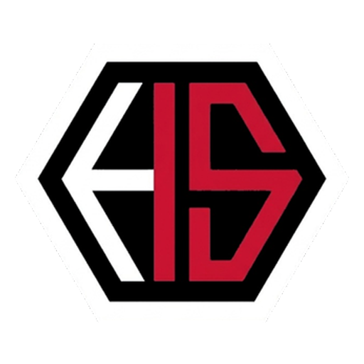

  

<h1 align="center">Website Komunitas HS15</h1>

  <strong>Portal dokumentasi dan arsip digital kegiatan komunitas HS15.</strong>

  
  
  
  
  
  
  
  

  

    <a href="#ringkasan">Ringkasan</a> •
    <a href="#tech-stack">Tech Stack</a> •
    <a href="#lisensi">Lisensi</a>
  

---

## Ringkasan

Website ini merupakan ruang dokumentasi digital yang didedikasikan untuk mengarsipkan setiap momen perjalanan touring, serta kegiatan kebersamaan seluruh anggota komunitas.

Website ini dirancang agar seluruh dokumentasi foto dan rekaman video dari berbagai agenda kegiatan tersusun rapi berdasarkan album perjalanan, mudah ditelusuri kembali, dan dapat diakses maupun diunduh dalam kualitas aslinya melalui perangkat desktop maupun mobile.

---

## Tech Stack

  
    

| Technology | Role |
| :--- | :--- |
|  | Core Web Framework (SSR + Prerender) |
|  | Progressive Reactive Frontend Engine |
|  | Modern Styling & Design Tokens |
|  | Semantic Tailwind Component Library |
|  | Type Safety & Client/Server Contracts |
|  | Edge CDN & Cloud Deployment Platform |
|  | Headless Media Storage & Archival API |

---

## Lisensi

Proyek ini dilisensikan di bawah **MIT License**. Silakan lihat berkas [LICENSE](LICENSE) untuk ketentuan dan informasi hak cipta selengkapnya.

---

   
  
   
  Dikembangkan untuk <strong>HS15</strong> oleh <a href="https://github.com/zerabyte88">zerabyte88</a>

